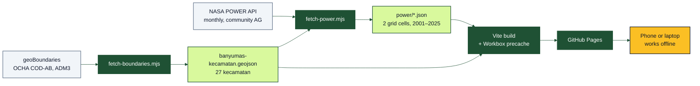

<!-- markdownlint-disable MD013 MD033 MD041 -->
<!-- AI-assisted: generated with Claude (Anthropic). See README, "Use of AI". -->

<div align="center">


# Field Shift Banyumas

**Working title · Team Wingman Clutch · NASA Space Apps Challenge 2026**

Our entry for the challenge [**Field Shift: Adapting Farms with NASA Data**](https://www.spaceappschallenge.org/2026/challenges/adapting-farms-with-nasa-data/), focused on Banyumas Regency, Central Java, Indonesia.<br />
A responsive web app that installs as a PWA and keeps working without internet.

### [Open the app →](https://wingman-clutch.github.io/field-shift-banyumas/)

[](https://wingman-clutch.github.io/field-shift-banyumas/)
[](https://www.spaceappschallenge.org/2026/challenges/adapting-farms-with-nasa-data/)
[](https://power.larc.nasa.gov/)
[](#features)
[](https://react.dev)
[](https://www.typescriptlang.org)
[](https://vite.dev)
[](https://leafletjs.com)
[](https://www.openstreetmap.org)

[Features](#features) · [How it works](#how-it-works) · [Getting started](#getting-started) · [Data sources](#data-sources-and-licenses) · [Use of AI](#use-of-ai) · [Team](#team)

</div>

> [!NOTE]
> **Built during the NASA Space Apps Challenge, 14–15 November 2026.** This is the base of the project: a map of the 27 subdistricts (*kecamatan*) of Banyumas and NASA climate data that keep working offline. The team's solution is being built on top of it, and this README grows with it.

## Features

What works today:

- **Map of Banyumas** with all 27 kecamatan. Tap one to select it, or pick it from the list.
- **Monthly climate** for the selected kecamatan from [NASA POWER](https://power.larc.nasa.gov/): rainfall and temperature, averaged per calendar month over 2001–2025.
- **Installable and offline.** Add it to the home screen. After the first visit, the app and its data load without internet.
- **Phone first.** On a phone the details open in a bottom sheet; on a laptop they sit in a side panel.

### Current flow

```mermaid
%%{init: {"theme":"base","themeVariables":{"fontFamily":"ui-sans-serif, system-ui","primaryTextColor":"#0f172a","lineColor":"#1f5134"},"flowchart":{"curve":"basis"}}}%%
flowchart LR
    A["1 · Open the app<br/>online or offline"] --> B["2 · Map of Banyumas<br/>27 kecamatan"]
    B --> C["3 · Pick a kecamatan<br/>tap the map or use the list"]
    C --> D["Monthly climate<br/>rainfall · temperature"]
    D --> E["Team feature area<br/>being built"]

    classDef step fill:#f1f5f9,stroke:#1f5134,color:#0f172a,stroke-width:1.5px;
    classDef result fill:#d9f99d,stroke:#1f5134,color:#0f172a,stroke-width:1.5px;
    classDef next fill:#ffffff,stroke:#64748b,color:#475569,stroke-width:1.5px,stroke-dasharray:4 3;
    class A,B,C step;
    class D result;
    class E next;
```



## How it works

External data is downloaded once by two scripts and saved as small static files. The app reads those files, so it never calls an API at runtime except for map tiles.



An interactive architecture diagram that links to the code, like the ones in our other projects, will be added once the main features are in.

<details>
<summary><b>Data details</b>: parameters, grid cells, and how the chart is computed</summary>

| Parameter | Meaning | Unit |
| --- | --- | --- |
| `PRECTOTCORR` | Precipitation, bias-corrected | mm/day |
| `T2M` | Air temperature at 2 m | °C |
| `T2M_MAX` / `T2M_MIN` | Maximum / minimum air temperature at 2 m | °C |
| `RH2M` | Relative humidity at 2 m | % |
| `ALLSKY_SFC_SW_DWN` | Solar radiation reaching the surface | MJ/m²/day |
| `GWETROOT` | Root-zone soil wetness | 0–1 |

- NASA POWER is a grid of about 50 km (0.5° × 0.625°). The 27 kecamatan fall into **2 grid cells**, so the panel shows regional conditions, not field-level ones.
- Monthly rainfall in the chart is `PRECTOTCORR` × days in the month, averaged per calendar month over 2001–2025.
- `public/data/power/index.json` maps each kecamatan to its grid-cell file.

</details>

## Getting started

Requires Node.js 20.19+ or 22.12+ (CI uses Node 24).

```bash
npm install        # also turns on the git hooks
npm run dev        # development server
npm run build      # type check + production build into dist/
npm run preview    # serve dist/ locally, service worker included
```

The generated files in `public/data/` ship with the repo, so you don't need to download anything to run the app. To refresh them:

```bash
npm run data:boundaries   # geoBoundaries → public/data/banyumas-kecamatan.geojson
npm run data:power        # NASA POWER   → public/data/power/*.json (needs the boundaries file)
npm run icons             # regenerate the PWA icons from public/logo.svg
```

<details>
<summary><b>Project structure</b></summary>

```
public/
  data/banyumas-kecamatan.geojson   kecamatan boundaries (27 features) + source metadata
  data/power/index.json             kecamatan → NASA POWER grid-cell file
  data/power/merra2_*.json          monthly NASA POWER data per grid cell
  logo.svg, pwa-*.png, …            placeholder logo and generated PWA icons
scripts/
  fetch-boundaries.mjs              downloads and filters geoBoundaries
  fetch-power.mjs                   downloads NASA POWER monthly point data
  check-no-ai.sh                    rejects AI attribution in commits and PRs (AGENTS.md)
src/
  App.tsx                           layout: header, map, side panel / bottom sheet
  components/                       map, climate panel and chart, placeholder, footer
  lib/                              data loading, climatology helper, types
.github/workflows/                  CI, GitHub Pages deploy, no-AI-attribution check
.githooks/                          commit-msg and pre-push hooks
```

</details>

## Deploy

Every push to `main` builds the app and publishes it to GitHub Pages at [wingman-clutch.github.io/field-shift-banyumas](https://wingman-clutch.github.io/field-shift-banyumas/) (workflow `Deploy to GitHub Pages`). The build uses `BASE_PATH=/field-shift-banyumas/`, so the app, its data, and the service worker all live under that sub-path. To build for another sub-path, run `BASE_PATH=/<path>/ npm run build`.

## Data sources and licenses

| Data | Source | License / terms |
| --- | --- | --- |
| Monthly climate, 2001–2025 | [NASA POWER](https://power.larc.nasa.gov/) monthly point API, community AG | NASA open data. *"These data were obtained from the NASA Langley Research Center (LaRC) POWER Project funded through the NASA Earth Science/Applied Science Program."* |
| Kecamatan boundaries (IDN ADM3, 2019) | [geoBoundaries](https://www.geoboundaries.org/) gbHumanitarian, from OCHA ROAP / HDX ([COD-AB Indonesia](https://data.humdata.org/dataset/cod-ab-idn)) | CC BY 3.0 IGO. Runfola, D. et al. (2020) geoBoundaries: A global database of political administrative boundaries. *PLoS ONE* 15(4): e0231866. |
| Basemap tiles | [OpenStreetMap](https://www.openstreetmap.org/copyright) | © OpenStreetMap contributors, ODbL |

The geoBoundaries **gbOpen** release has no Indonesian ADM3, so the **gbHumanitarian** release is used.

## Use of AI

NASA Space Apps asks every team to show where and how AI ("Super Intelligence") was used. Here is ours.

- **Tool:** Claude (Anthropic), used through Claude Code as a coding assistant.
- **Used for:** the project base (app shell, map, climate panel, PWA setup), the data download scripts, and drafts of this README and of [`AGENTS.md`](AGENTS.md).
- **Not used for:** coming up with our solution idea. The team decides the idea, the users, and the features.
- **Markers:** every AI-assisted file starts with a one-line `AI-assisted` comment, generated data files carry a `processing` field in their metadata, and the placeholder logo (`public/logo.svg`) is SVG code drawn by the same tool.
- **Review:** all changes go through pull requests so the team can review them.
- The data values come unchanged from the sources listed above.

## Working rules

How we work in this repo is in [`AGENTS.md`](AGENTS.md): no AI attribution in commits and PRs (checked by git hooks and CI), the partner as co-author on every commit, Conventional Commits in English, and the AI disclosure that NASA Space Apps requires inside the project.

## Team

<table>
  <tr>
    <td align="center"><a href="https://github.com/bintangfabian"><br /><b>Bintang Fabian Putra</b></a><br /><sub>@bintangfabian</sub></td>
    <td align="center"><a href="https://github.com/HaikalFaruq"><br /><b>Muhammad Haikal Faruq</b></a><br /><sub>@HaikalFaruq</sub></td>
  </tr>
</table>

Team **Wingman Clutch**, NASA Space Apps Challenge 2026, Local Event Purwokerto.
